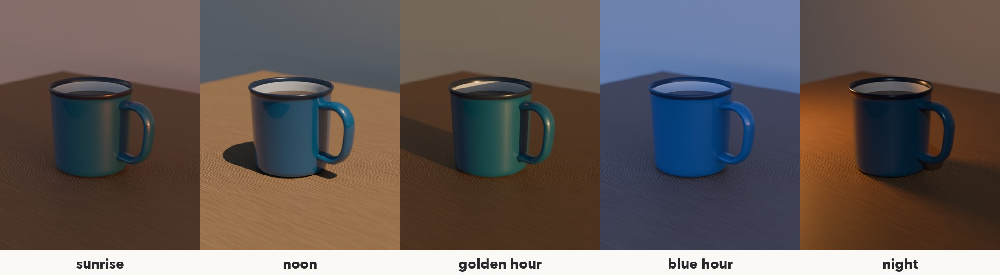
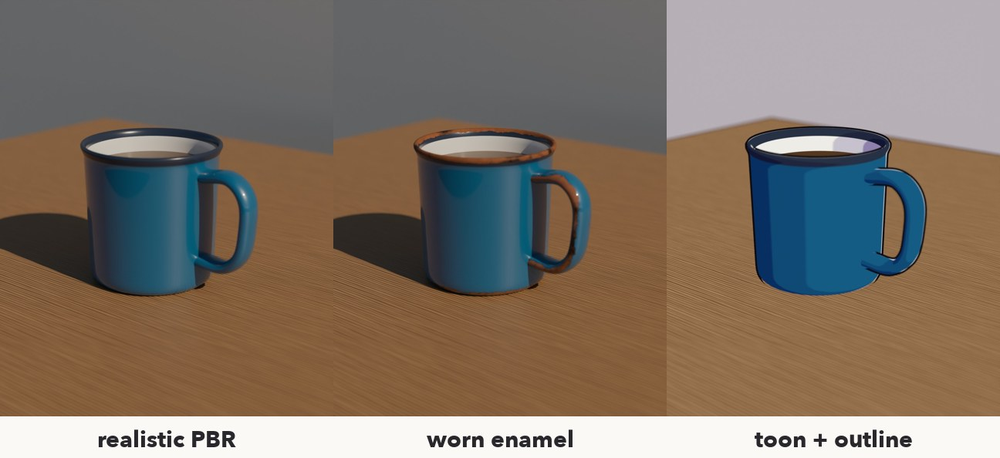

# Examples

All rendered locally on a Mac M1 with Blender 5.3 (Cycles, Metal), using only this repo's skill scripts plus `scene_mug.py`, which models the mug and the table. Each frame took 16–19 s at 1080×1350.

`R` below stands for `python skills/blender-core/scripts/run_in_blender.py`.

## Same mug, five times of day (`blender-time-of-day`)



```bash
R examples/scene_mug.py -- --save out/mug.blend
R --blend out/mug.blend skills/blender-asset-qa/scripts/qa_check.py -- --objects Mug Handle Coffee --profile render
R --blend out/mug.blend skills/blender-pbr-materials/scripts/build_pbr_material.py -- --name M_Enamel --preset paint --color 0.08 0.36 0.52 --objects Mug Handle --save out/base.blend
R --blend out/base.blend skills/blender-time-of-day/scripts/scene_mood.py -- --time golden --save out/golden.blend   # sunrise | noon | golden | blue_hour | night
R --blend out/golden.blend skills/blender-rendering/scripts/render_batch.py -- --engine CYCLES --samples 160 --out out/golden --frames 1
```

- On its first run, the QA check caught a real modeling error: the handle's ends sat flush against the mug wall (z-fighting). It passed once the ends were sunk into the wall.
- Night follows the skill's own rule ("night needs practicals"): one 2700 K point light out of frame at 1.6 W, with exposure lowered to −0.6.
- The skill's volumetric fog is sized for landscapes (visibility in meters). On a one-meter tabletop it only darkened the frame, so this set uses blue hour instead.

## Same mug, three styles (`blender-pbr-materials`, `blender-texturing`, `blender-stylized-npr`)



```bash
R --blend out/base.blend skills/blender-time-of-day/scripts/scene_mood.py -- --time afternoon --save out/real.blend
R --blend out/real.blend skills/blender-texturing/scripts/smart_material.py -- --objects Mug Handle --wear 0.35 --rust 0.1 --grime 0.45 --dust 0.1 --breakup 0.4 --edge-width 0.004 --scale 0.02 --under-color 0.16 0.15 0.14 --under-metallic 1 --under-roughness 0.5 --save out/worn.blend
R --blend out/real.blend skills/blender-stylized-npr/scripts/toon_setup.py -- --objects Mug Handle Coffee Table Wall --bands 3 --rim 0.35 --outline 0.0012 --save out/toon.blend
```

- Wear is driven by curvature, and a cylinder is convex almost everywhere (72% of its vertices). With `--wear 0.7 --rust 0.35` the whole mug turned to rust. Lower values keep the chips on the rim, the handle and the base.
